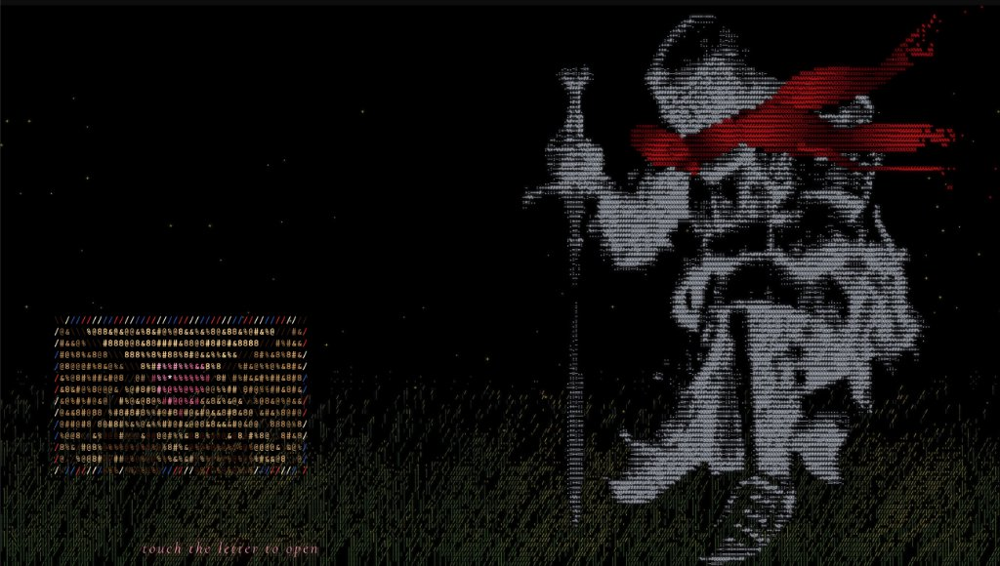
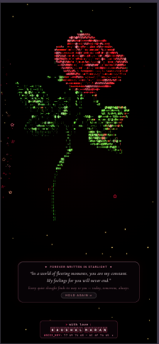

# 🌹 LIVE ASCII — For You

[](https://kaushalboii.github.io/LIVE-ASCII/)
[](https://github.com/kaushalboii/LIVE-ASCII/releases)
[](LICENSE)
[](#)

> **“In a world of fleeting moments, you are my constant. My feelings for you will never end.”**  
> A romantic interactive storytelling web experience built with pure vanilla HTML5, Canvas 2D, and mathematical 24-bit true-color glowing ASCII art.

---

## 📸 Preview



---

## ✨ The Journey

### ⚔️ Act I — The Vigil of the ASCII Knight
- **The Knight in Moonlight**: An ASCII knight standing vigil on the right flank, his vibrant red cloak flowing in the night breeze.
- **The Sealed Letter**: A wax-stamped envelope marked **"FOR YOU"** nestled in the grass in the bottom-left corner.
- **The Ignition**: Touching the letter ignites dynamic flame physics — radiant sparks, burning paper embers, and drifting smoke unveil what lies inside.

---

### 💖 Act II — The Multilingual Love Heart
- **Mathematical Heart Curve**: Procedural heart geometry filled with *"I love you"* translated across international languages — including **Tamil** (*நான் உன்னை காதலிக்கிறேன்*), Spanish (*Te amo*), French (*Je t'aime*), Japanese (*愛してる*), Korean (*사랑해*), Hindi (*मैं तुमसे प्यार करता हूँ*), and more.
- **The Badge Glide**: Upon completion, the heart gently ascends and docks into the top-left corner as a luminous celestial logo badge.

---

### 🌹 Act III — The Grand Living Crimson Rose

<p align="center">
  
</p>

- **High-Definition Glowing ASCII Art**: Thousands of vibrant characters rendered in real time at 60 FPS using 24-bit true-color rasterization.
- **100% Pure Velvet Crimson Red Petals**: Rich burgundy crevice shadows (`#38030c`), radiant ruby crimson body (`#d81033`), glowing scarlet highlights (`#ff3d68`), and luminous petal rim reflections.
- **Natural Botanical Anatomy**:
  - Full-height sinuous green stem rising from the floor with hooked thorns.
  - Serrated emerald rose leaves with veins and foliage textures.
  - Layered chalice whorls with a spiral Fibonacci bud core.
- **Living Organic Motion**:
  - Blossoms smoothly from a tight bud into full bloom over $3.6\text{s}$.
  - **Stays in Full Bloom Forever**: Once bloomed, it never closes or shrinks into a ball.
  - Multi-harmonic breeze sway anchored at the stem root with gentle living breath ($\pm 1.5\%$) and ambient golden stardust fireflies.
  - Zero row-shearing tearing or edge cuts.
- **Universal Responsive Design**: Dynamically scales across mobile, tablet, and widescreen desktop displays with uniform character density.

---

### 💌 Act IV — The Starlight Note & Signature
- **Poetic Note Card**:
  > *✦ FOREVER WRITTEN IN STARLIGHT ✦*  
  > *“In a world of fleeting moments, you are my constant.*  
  > *My feelings for you will never end.”*  
  > *Every quiet thought finds its way to you — today, tomorrow, always.*
- **Pure ASCII Keycap Signature**:
  - `> with love : KAUSHAL MARAN`
  - Sculpted keyboard keycaps with tactile glowing borders and ASCII byte encoding: `77 69 74 68 • 6C 6F 76 65 ✦`.
- **Responsive Layout**: Specially optimized for mobile, tablet, and desktop with zero overlap and comfortable breathing clearance.

---

## 🛠️ Tech Stack & Architecture

- **Rendering**: Pure HTML5 Canvas 2D + 32-bit pixel buffer rasterization (`ImageData`) & glowing monospace glyphs.
- **No Frameworks**: 100% Vanilla ES6 Modules, 0 KB external runtime dependencies.
- **Audio Engine**: Synthesized romantic Web Audio API harmonic chimes.
- **Styling**: Modular CSS3 with hardware-accelerated backdrop blur and pure pitch black background (`#000000`).

---

## 🌐 Live Website

Experience it live at:  
👉 **[https://kaushalboii.github.io/LIVE-ASCII/](https://kaushalboii.github.io/LIVE-ASCII/)**

---

## 📱 Android Interactive Widget App

You can run LIVE ASCII directly on your Android phone as an **interactive floating widget** or add it to your home screen!

- **Interactive Floating Widget**: A floating, draggable card running the live 60 FPS ASCII Canvas directly on top of your home screen. Touch the letter to burn it open, watch the rose bloom, and tap the quote buttons anytime!
- **Minimize to Badge**: Tap the minimize button `—` to tuck the widget into a cute floating `🌹` badge on the edge of your screen; tap it again to expand.
- **Home Screen Widget**: Also includes a native Android home screen app widget that you can pin between your launcher icons.
- **Automated Cloud Build**: Built automatically via GitHub Actions as a downloadable APK.

👉 **[Download the Android APK from GitHub Releases](https://github.com/kaushalboii/LIVE-ASCII/releases)** or check the [GitHub Actions artifacts](https://github.com/kaushalboii/LIVE-ASCII/actions).

---

## 💻 Local Setup

```bash
# Clone the repository
git clone https://github.com/kaushalboii/LIVE-ASCII.git
cd LIVE-ASCII

# Run local web server (Python)
python3 -m http.server 8000

# Or using Node.js
npx serve .
```

Open `http://localhost:8000` in any modern browser (Safari, Chrome, Firefox, Edge).

---

## 📜 License

MIT License &copy; 2026 Kaushal Maran. Built with passion and love.
